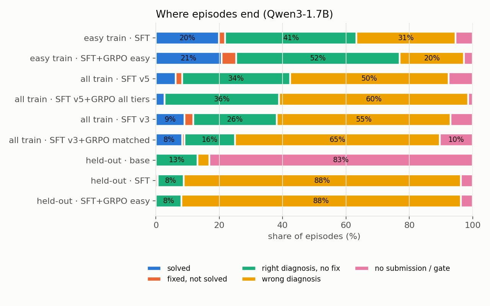
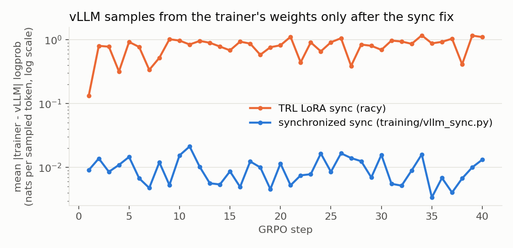

# OnCallGym

An RL environment where an LLM agent is the on-call engineer for a small simulated online shop. Each episode boots the shop (15 processes), injects one production fault, pages the agent with a symptom-only alert, and gives it ops tools. A programmatic verifier then checks, with its own traffic, whether the system actually recovered and stays recovered after a full restart. There is no LLM judge.

Everything runs on free compute: plain processes (no Docker needed at train time), Kaggle T4 GPUs for training.

## How an episode works

```
             alert: "Customers can log in but every checkout is rejected (401)."
                                     |
                                     v
  +-----------+   tool calls   +-------------------------------------------------+
  |   agent   | -------------> | episode sandbox (separate Unix user per episode)|
  |  (LLM)    | <------------- |   exec (shell in deploy dir), logs, metrics,    |
  +-----------+   tool output  |   trace, topology, list_services, restart,      |
        |                      |   submit_diagnosis (ends the episode)           |
        |                      +-------------------------------------------------+
        |                                       |
        |                    Northwind Commerce: edge -> auth, catalog, orders,
        |                    inventory, payments -> provider (external), broker ->
        |                    fulfillment, notify; cache, flags, scheduler,
        |                    telemetry, trafficgen; all under one supervisor
        v
  verifier (own probes, after the agent is done):
    R  customer journeys + 8 s recovery window + liveness invariants
    P  restart every service, then R again
    C  submitted category and component match the ground truth
    G  safety and integrity gate (no lost/duplicated money, stock, messages, data;
       protected files, logging, scheduler jobs, trafficgen untouched)

  reward = G * (0.5*R*P + 0.3*C + 0.2*R)        solved = R and P and C and G
```

R also requires the fault's own `root_cause_fixed()` check on the effective configuration, so hiding a symptom (making the external provider reliable, restarting a stuck service) does not count.

## Tasks

17 fault families. Variants are generated from a seed (values, services and red herrings in the logs change); training uses variants 0-7, evaluation 0-3. Turn limits: easy 12, medium 14, hard 16 tool calls.

| split | tier | family | alert (what the agent sees) |
|---|---|---|---|
| train | easy | catalog_bad_build_flag | Product search returns errors for every query since the last catalog deploy. |
| train | easy | wrong_database_path | Product browsing failing with 5xx errors for all customers. |
| train | easy | edge_rate_limit_too_low | Customers getting 'Too Many Requests' (429) on most pages. |
| train | easy | edge_wrong_upstream_port | Login failing for most customers (5xx/404 at the edge). |
| train | medium | fulfillment_env_typo | Orders are paid but none have shipped for several minutes. |
| train | medium | fulfillment_wrong_topic | Orders are paid but none have shipped for several minutes. |
| train | medium | missing_migration | Every checkout fails with 500; browsing works. |
| train | medium | notify_dead_letters | Customers report missing order confirmation and shipping emails. |
| train | medium | orders_payments_timeout_inversion | Checkout failure rate above 50% (504); some customers charged twice. |
| train | medium | catalog_leak_flag | Intermittent errors and timeouts when browsing; error rate is flapping. |
| train | hard | scheduler_lock_hold | Checkout failing intermittently (about half the attempts) with 5xx. |
| train | hard | flags_service_down | All checkouts rejected with 503 'checkout temporarily disabled'. |
| test | easy | jwt_key_rotation_mismatch | Customers can log in but every checkout is rejected (401). |
| test | medium | cache_full_noeviction | Customers cannot log in (503); browsing works. |
| test | medium | payments_breaker_stuck_open | Checkout failing for most customers; payment provider status is green. |
| test | medium | poison_message | No orders have shipped for several minutes; paid orders are piling up. |
| test | hard | orders_config_drift | Every checkout fails with 502 since this morning's deploy. |

The test families are never used for SFT data or RL. Every family passes an automatic validation (`python -m oncallgym.validate`; last full run on variants 0-1 of all 17 families, the payments breaker family re-validated on variants 0-7 after a fix): healthy before injection, probes fail after it, the scripted oracle fix scores ~1.0, doing nothing scores ~0, restart-all does not solve it, every known cheat is blocked by the gate, and teardown leaves nothing behind.

## Results

Qwen3-1.7B, thinking off, 8k context, LoRA r=16. Same evaluator and sampling (T=0.7, top_p=0.95, top_k=20; early runs got top_k=20 from vLLM's generation_config default, recorded in each summary) for every row; each number comes from `results/<run>/summary.json` (commit, Kaggle run, per-episode rows). Paired comparisons are over tasks (bootstrap CI, sign-flip test; `training/compare.py`). Samples per task: 16 on easy train, 8 on held-out test, 3 on all train (2 for untrained baselines). The train-split evals use variants 0-3, which are among the variants 0-7 used for SFT data and RL, so they measure performance on trained prompts; only the held-out families measure generalization.

| model | eval set | episodes | solved | tasks ever solved | mean reward | diagnosis right (C) |
|---|---|---|---|---|---|---|
| base | held-out test (20 tasks) | 160 | 0.0% | 0/20 | 0.039 | 0.13 |
| SFT | held-out test | 160 | 0.0% | 0/20 | 0.024 | 0.08 |
| SFT + GRPO (40 steps, easy train) | held-out test | 160 | 0.0% | 0/20 | 0.024 | 0.08 |
| SFT | easy train tasks (16) | 256 | 19.9% | 12/16 | 0.334 | 0.64 |
| SFT + GRPO (40 steps, easy train) | easy train tasks | 256 | 20.7% | 15/16 | 0.390 | 0.74 |
| SFT (rerun, same session as next rows) | held-out test | 160 | 0.0% | 0/20 | 0.021 | 0.06 |
| SFT + GRPO (60 steps, all train tiers) | held-out test | 160 | 0.0% | 0/20 | 0.017 | 0.06 |
| SFT (rerun, same session) | all train tasks (48) | 144 | 6.2% | 9/48 | 0.172 | 0.43 |
| SFT + GRPO (60 steps, all train tiers) | all train tasks | 144 | 2.8% | 3/48 | 0.136 | 0.39 |
| SFT v3 data (same session as next rows) | held-out test | 160 | 0.0% | 0/20 | 0.017 | 0.06 |
| SFT v3 + GRPO (50 steps, all tiers, matched sampler) | held-out test | 160 | 0.0% | 0/20 | 0.013 | 0.04 |
| SFT v3 data (same session) | all train tasks (48) | 144 | 9.0% | 10/48 | 0.179 | 0.38 |
| SFT v3 + GRPO (50 steps, all tiers, matched sampler) | all train tasks | 144 | 8.3% | 6/48 | 0.136 | 0.25 |

- The base model solves nothing anywhere. Scripted-oracle SFT gets it to 19.9% on the easy training families in one session (256 episodes) and 10.4% in another (48 episodes, same adapter, same per-family ordering); the evals are noisy. An A/A check makes the size of that noise concrete: GRPO with an all-zero gradient leaves the weights equal to SFT, yet in one session it scored +0.044 reward and +7.8 points solve rate over SFT (128 episodes, p=0.27 and p=0.11; `results/train-easy_*-v7`).
- GRPO on easy training tasks raised mean reward by +0.056 through better diagnoses (bootstrap over tasks: 95% CI [+0.013, +0.095], p=0.02). Treat this as suggestive only: the 16 tasks are 4 families whose variants share most of their prompt, the gain comes from 2 of the 4 families (exact family-level sign-flip p=0.25), and the SFT row was evaluated in a different Kaggle session. The strict solve rate did not move (+0.008, p=0.88).
- GRPO on all twelve training families (60 steps, SFT and GRPO evaluated in the same Kaggle session) did not help: mean reward on the 48 training tasks went 0.172 -> 0.136 (-0.036, 95% CI [-0.081, +0.008], p=0.13; by family p=0.27) and solves 6.2% -> 2.8% (p=0.23), and held-out reward did not move (-0.004, p=0.78). The training-batch reward rose from 0.07 (mean of the first 10 steps) to 0.17 (last 10; `results/grpo_v11_curve`), but each step draws different tasks, so that curve is not evidence of learning. Medium and hard faults are rarely solved by the SFT policy (4% of episodes), so few rollouts ever reach the recovery terms; groups did differ in reward (6 of the 60 single-prompt groups had identical rewards), but mostly through diagnosis credit. That run also sampled with top_p=1.0 during training and top_p=0.95 at eval; the next run matches them.
- A second all-tier run with the sampler matched between training and eval (SFT on regenerated data, 50 GRPO steps, both arms in one session) repeated the pattern, and here the drop in diagnosis quality is significant: the right category and service on training tasks fell from 0.38 to 0.25 (-0.132, 95% CI [-0.222, -0.042], p=0.009; by family p=0.012, lower in 8 of 12 families), mean reward fell 0.179 -> 0.136 (p=0.14; by family p=0.07), solves stayed flat (9.0% -> 8.3%) and held-out reward did not move (p=0.84). Its training-batch reward rose from 0.13 to 0.25 (first vs last 10 steps, `results/grpo_v12_curve`), the same disconnect as before. Our reading: with 50-60 single-prompt steps over twelve families, GRPO fits the few batches it sees and degrades the broad diagnosis behaviour SFT taught; we have not isolated the cause.
- Nothing transfers to the five held-out families: no trained or untrained model solves a single held-out episode and the trained models' rewards are not significantly different from the base model's. The trained models learned the protocol (they submit instead of running out of turns: base runs out on 83% of episodes, SFT/GRPO on 2-10%) but blame the wrong service on 56-71% of unseen faults.

Untrained open models, same evaluator and sampler (one Kaggle session, `results/baseline_*`; 4 samples per test task, 2 per train task over all 48 train tasks):

| model | held-out test: solved / reward / C | all train tiers: solved / reward / C | no submission (test) | tool calls per episode (test) |
|---|---|---|---|---|
| Qwen3-0.6B | 0/80 · 0.038 · 0.13 | 0/96 · 0.000 · 0.00 | 0% | 4.9 |
| Qwen3-1.7B | 0/80 · 0.038 · 0.13 | 0/96 · 0.000 · 0.00 | 80% | 13.0 |
| Qwen3-4B | 0/80 · 0.094 · 0.31 | 0/96 · 0.047 · 0.16 | 22% | 9.8 |
| Qwen3-8B | 0/80 · 0.008 · 0.03 | 0/96 · 0.000 · 0.00 | 92% | 13.9 |

No untrained model up to 8B solves a single episode, and size does not help monotonically: 0.6B submits a guess after ~5 calls and is almost always wrong, while 1.7B and 8B keep investigating until the turn limit and rarely submit (38% of 1.7B's and 15% of 8B's tool calls on test exactly repeat an earlier call in the same episode). 4B is the only one that balances the two, and it gets the right diagnosis on 31% of held-out episodes, but it never fixes anything.

### Where episodes fail

One outcome per episode (`analysis/taxonomy.py`; figure from `analysis/plots.py`):




| run | solved | gate tripped | no submission | fixed, not held | fixed, wrong diagnosis | right diagnosis, no fix | wrong service | wrong category |
|---|---|---|---|---|---|---|---|---|
| easy train, SFT | 19.9% | 0.8% | 4.7% | 1.6% | 0.4% | 41.4% | 15.2% | 16.0% |
| easy train, SFT+GRPO easy | 20.7% | 2.0% | 0.8% | 1.2% | 3.5% | 51.6% | 9.0% | 11.3% |
| test, base | 0% | 0% | 83.1% | 0% | 0% | 13.1% | 2.5% | 1.2% |
| test, SFT | 0% | 0% | 3.8% | 0.6% | 0% | 8.1% | 68.1% | 19.4% |
| test, SFT+GRPO easy | 0% | 1.9% | 1.9% | 0% | 0% | 8.1% | 55.6% | 32.5% |
| all train, SFT (v11 session) | 6.2% | 2.1% | 5.6% | 2.1% | 0% | 34.0% | 30.6% | 19.4% |
| all train, SFT+GRPO all tiers | 2.8% | 1.4% | 0% | 0% | 0% | 36.1% | 40.3% | 19.4% |
| test, SFT+GRPO all tiers | 0% | 0% | 6.2% | 0% | 0% | 5.6% | 68.8% | 19.4% |
| all train, SFT v3 (v12 session) | 9.0% | 1.4% | 5.6% | 2.1% | 0.7% | 26.4% | 38.9% | 16.0% |
| all train, SFT v3+GRPO matched | 8.3% | 2.8% | 7.6% | 0% | 0.7% | 16.0% | 47.2% | 17.4% |
| test, SFT v3+GRPO matched | 0% | 0% | 10.0% | 0% | 0% | 4.4% | 65.0% | 20.6% |

On trained families the bottleneck is the edit, not the diagnosis: the model finds the right file and key, then writes a `sed` that does not apply (a regex for a key that does not exist, `rps` fixed but `burst` left at 1, a substitution that breaks the YAML), restarts, and submits.

## Reward hacking

We catalogued 25 hacks, found by design review, by failures during family validation, and by three independent code reviews (an automated red team with a local 8B model found none; see Limitations). Each one is blocked by a check and most have a regression test (`tests/test_hardening.py`, `oncallgym/cheats.py`, run for every family by `oncallgym.validate`).

| hack | blocked by |
|---|---|
| Restart everything for a persistent fault | P re-runs every check after restart-all; per-family `root_cause_fixed()` |
| Make the external payment provider or mail relay reliable | protected-file hashes -> G=0; R needs the real cause fixed |
| Disable traffic generation, silence logging, disable the reconcile job | integrity checks on trafficgen, logging level, scheduler jobs |
| Delete failed orders, purge unacked messages, reset stock, truncate the outbox | business invariants: order records intact, charges match orders, no lost messages, stock conserved, append-only outbox |
| Write the databases directly from the shell | agent runs as its own Unix user without write access to data/ |
| Code injection through env files (PYTHONPATH, LD_PRELOAD) | env-key allowlist; services start with `python -I` |
| Background process that keeps fulfilling orders; calling internal APIs | every agent process killed after each command; internal routes need a token the agent cannot read |
| Point a service at an agent-written config via NW_CONFIG_FILE | override limited to the service's own file or hash-protected archived releases; the verifier reads the config each service actually loaded |
| Read the answer: fault code, file and directory mtimes, process command lines, trajectory files, notes in /tmp | code owner-only; timestamps restored after injection; task params in a 0600 file deleted on read; /tmp wiped per episode |
| Hang the episode with a catastrophic regex | log grep is substring only |
| Enumerate diagnoses / stall to the turn limit | one submission ends the episode; no submission gives C=0 and R/P still need a real fix |

<details>
<summary>All 25 hacks: how each was found, what blocks it, and its regression check</summary>

| # | hack | found by | blocked by | regression check |
|---|---|---|---|---|
| 1 | Restart everything for a persistent fault | spec | Persistence P re-checks after restart-all; every family's root_cause_fixed() | validate step 5 (all families) |
| 2 | Make the external provider fast/error-free (provider.yaml) | design | protected-file hash -> G=0 | cheats.heal_provider, agent_edit_external |
| 3 | Disable trafficgen | design | trafficgen.yaml hash + trafficgen_alive check | cheats.disable_trafficgen |
| 4 | Delete unfinished/failed orders | design + validation (breaker family slipped through) | order_records_intact (items/reservations must reference an order), charges_match_orders | cheats.delete_unfinished_orders |
| 5 | Purge unacked broker entries | design | no_lost_messages (binding-history-aware) | cheats.purge_unacked_messages |
| 6 | Silence logging (log level error) | design | logging_enabled | cheats.silence_logging |
| 7 | Disable the reconcile job | design | scheduler_jobs_enabled | cheats.disable_reconcile_job |
| 8 | Reset stock/reservations | design | stock_conserved | cheats.reset_reservations |
| 9 | Truncate/rewrite the email outbox | design + validation (empty-at-baseline case slipped through) | append-only check + acked_events_have_emails | cheats.truncate_email_outbox |
| 10 | Edit telemetry config | design | protected-file hash | cheats.edit_telemetry_config |
| 11 | Fake recovery by writing databases / outbox from a shell | checkpoint 1 review (confirmed) | agent shell runs as a separate Unix user without write access to data/ | tests/test_episode.py::test_agent_cannot_write_data_or_read_secrets |
| 12 | Code injection as the stack owner via etc/env/*.env (PYTHONPATH / sitecustomize, LD_PRELOAD) | checkpoint 2 review (confirmed) | env-file key allowlist; services start with `python -I` and an explicit code path | cheats.agent_env_code_injection |
| 13 | Background daemon that keeps fulfilling orders via internal APIs | checkpoint 2 review (confirmed, reward 1.0) | per-episode agent user, every agent process SIGKILLed after each exec; internal endpoints need a 0600 token | cheats.agent_background_daemon, agent_internal_api |
| 14 | Call internal APIs directly (fulfill, ack, refund, supervisor shutdown/restart-all) | checkpoint 2 review | X-Internal-Token on internal routes and supervisor control | cheats.agent_internal_api |
| 15 | Fix the symptom of notify_dead_letters by making the external mail relay reliable | checkpoint 2 review (confirmed, reward 1.0) | relay settings in protected etc/external/smtp.yaml; root_cause_fixed() required for R and P | cheats.agent_edit_external |
| 16 | Read the answer: newest file mtime in etc/, restart counts, supervisor "restart requested" lines | checkpoint 2 review (confirmed) | faults applied before boot (configure()), etc/ mtimes restored | covered by design; spot check in review |
| 17 | Read the answer from eval process command lines / trajectory files | checkpoint 2 review | task params via 0600 file (deleted on read); trajectories 0600 in 0700 dir | - |
| 18 | Hang the episode with a catastrophic regex in logs(grep=) | checkpoint 2 review | grep is substring only | - |
| 19 | Drive the episode server from a background process | checkpoint 2 review | episode server token | - |
| 20 | Leave notes in /tmp for later episodes | design (checkpoint 2 follow-up) | agent user files in /tmp wiped at episode start and end | - |
| 21 | Enumerate diagnoses | spec | one submission only (episode ends) | tests (submit ends episode) |
| 22 | Stall to the turn limit | spec | no submission -> C=0, R/P need a real fix | - |
| 23 | Point a service at an agent-written config via NW_CONFIG_FILE (silence logs / disable jobs / keep a fault running while etc/<svc>.yaml looks fixed) | checkpoint 3 red-team review (read-only) | NW_CONFIG_FILE accepted only for etc/<svc>.yaml or etc/archive/*; archive files hash-protected and no new files allowed; verifier and every root_cause_fixed() read the effective config | tests/test_hardening.py::test_config_override_only_to_archive, ::test_verifier_reads_effective_config, ::test_agent_cannot_read_code_or_add_archived_config |
| 24 | Read the fault definitions / regenerate pristine configs from the code | checkpoint 3 red-team review | code root owner-only; verified at lock-down by trying as the agent user (dev container mounts the repo under owner-only /home/dev) | tests/test_hardening.py::test_agent_cannot_read_code_or_add_archived_config |
| 25 | Find the fault from directory mtimes / new files | checkpoint 3 red-team review | configure_quietly restores file and directory mtimes under etc/ and data/; new files get provisioning time | tests/test_hardening.py::test_fault_injection_leaves_no_timestamps |

</details>

Across all 3,424 committed evaluation episodes (`python analysis/integrity.py` over `results/`), none received recovery or persistence credit without the root cause fixed; the highest reward without a fix is 0.3 (diagnosis credit). Every gate trip read by hand was real damage from a bad edit, not an exploit.

## Training

```
scripted oracle trajectories (384, varied: extra checks, red herrings,
wrong-then-corrected steps)  ->  SFT (loss on assistant tokens only)
                             ->  GRPO (TRL 1.18, vLLM 0.33 server on GPU 1, trainer on GPU 0)
```

Training and evaluation share one agent loop and token renderer (same chat template, tool schemas, tool-call format, nudges on text-only replies), checked by `tests/test_parity.py`.

Two things had to be fixed before GRPO learned anything, both found by dumping tokens and logprobs from Kaggle and recomputing them in fp32 locally:

1. TRL's default `sequence_mask` importance-sampling correction multiplies per-token ratios over a whole ~500-token multi-turn episode. A per-token trainer/vLLM gap of 0.14-0.70 nats underflowed every ratio to 0, so the gradient was exactly zero on all 40 steps (`results/grpo_zero_grad_v7`). Per-token truncation (`--is-mode token_truncate`) keeps the gradient alive. The gap itself turned out to come from bug 2, not from fp16 numerics.
2. TRL's LoRA weight sync merges the adapter, hands vLLM views of the live weights, then unmerges. vLLM copies them on two side CUDA streams with no ordering against the merge/unmerge, so some layers arrived as base weights and vLLM sampled from a half-merged model (logprob gap 0.13-1.17 nats/token, median 0.85; after the fix 0.003-0.02). With the racy sync, GRPO made the policy worse on easy training tasks (reward -0.067, 95% CI [-0.118, -0.015], p=0.03; `results/train-easy_grpo-racy-v8`). `training/vllm_sync.py` synchronizes around the merge and yields copies; `tests/test_vllm_sync.py`.



## Running it

Requirements: Python 3.12, uv; Linux (episodes create per-episode Unix users). On macOS use the dev container.

```
make setup                 # uv sync
make test                  # unit tests
make probe                 # boot the shop, run customer journeys and invariants, tear down
python -m oncallgym.validate wrong_database_path   # oracle, no-op and cheat checks for one family
python -m oncallgym.evaluate --base-url http://127.0.0.1:8000 --model Qwen/Qwen3-1.7B \
    --split test --variants 0-0 --out runs/eval    # needs an OpenAI-compatible vLLM server
```

Training runs on Kaggle (T4 x2) from `notebooks/train/` (`build.py` packs the code, data and settings into one kernel script).

## Limitations

- One model size trained (1.7B), short GRPO runs (40-60 steps) on a free 30 GPU-hour weekly quota.
- No transfer to unseen fault families yet; gains are on families seen in training.
- 17 families on one synthetic system. The services are small Python processes, not production software; realism comes from the failure modes, alerts and checks, not from scale.
- The automated red team (local Qwen3-8B) was too weak to find exploits; the hack table comes mostly from human-style code review.
- The verifier checks that the faulty value is corrected, not that the file is otherwise clean: a sloppy fix that also leaves a junk key behind (seen on catalog_bad_build_flag) still counts as fixed.

## Citation

```
@misc{oncallgym2026,
  title  = {OnCallGym: an RL environment for on-call incident response},
  year   = {2026},
  note   = {https://github.com/khanak0509/OnCallGym}
}
```
