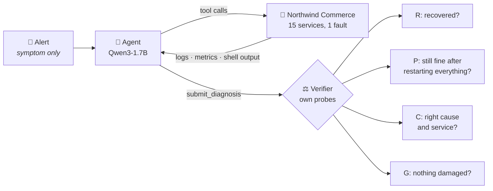
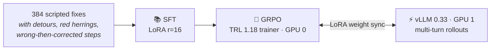

<div align="center">

# 🚨 OnCallGym

**An RL gym where a language model takes the pager.**

It boots a small online shop, breaks something in production, wakes the agent up with an alert,<br>
and then checks with its own traffic whether the agent really fixed it.


[What it is](#-what-it-is) ·
[A real episode](#-a-real-episode) ·
[Results](#-results) ·
[Reward hacking](#-reward-hacking) ·
[Training bugs](#-two-bugs-that-silently-broke-training) ·
[Run it](#-run-it)

</div>

---

## 💡 What it is

Being on call is a very particular skill. Something is broken, customers are unhappy, and all you have is an alert, a terminal, some logs and dashboards. You have to find the cause, fix it without breaking anything else, and say what went wrong.

I wanted to know whether a small open model can learn that with reinforcement learning, so I built the environment to train it in.

- 🏪 **Northwind Commerce**, a small online shop made of **15 real processes**: an edge gateway, auth, catalog, orders, inventory, payments, a message broker, fulfillment, email, cache, feature flags, a scheduler and more. They have real config files, logs, SQLite databases and HTTP calls between them.
- 💥 **17 kinds of production fault**: bad deploys, wrong ports, a rate limit set to almost zero, a cache that refuses writes, a circuit breaker stuck open, poison messages and more. Each one comes in seeded variants. **5 are held out completely** to test whether anything generalizes.
- 🧰 **8 tools**, the same kind a human would reach for: `exec` (a shell), `logs`, `metrics`, `trace`, `topology`, `list_services`, `restart` and `submit_diagnosis`.
- ⚖️ **A verifier, not a judge.** No LLM grades anything. After the agent is done, the verifier sends its own customer traffic, restarts every service and checks again, compares the diagnosis to the ground truth, and checks that no money, stock, messages or data were lost along the way.



**Reward** = `G × (0.5·R·P + 0.3·C + 0.2·R)` &nbsp;&nbsp;·&nbsp;&nbsp; **Solved** = R and P and C and G all pass

Recovery also requires the family's own `root_cause_fixed()` check on the config each service actually loaded. Hiding the symptom doesn't count; the cause has to be fixed.

---

## 🎬 A real episode

This one is from the evaluation logs, not made up. The alert says customers get `429 Too Many Requests` on most pages.

```text
🔔  Customers getting 'Too Many Requests' (429) on most pages.

$ list_services                      → everything running and ready
$ metrics                            → error rate and latency per service
   (list_services and metrics once more; trimmed here)
$ logs edge --grep "rate limit"      → msg="rate limit exceeded" client=user-3 ...
$ grep -n -A3 '^rate_limit:' etc/edge.yaml
    40-  rps: 0.1
    41-  burst: 1                    ← there it is
$ sed -i 's/^  rps: .*/  rps: 20/; s/^  burst: .*/  burst: 40/' etc/edge.yaml
$ restart edge                       → edge restarted and ready
$ submit_diagnosis config / edge  "edge rate_limit was set near zero; restored rps 20 burst 40."

⚖️  R ✅  P ✅  C ✅  G ✅   reward 1.00, solved
```

In 9 tool calls it found the cause, fixed it and explained it. A lot of the time it doesn't go this well, and the results below show where it fails.

<details>
<summary><b>📋 All 17 fault families and the alerts the agent sees</b></summary>

<br>

Variants are generated from a seed (values, affected services and red herrings in the logs change). Training uses variants 0-7 and evaluation 0-3. Turn limits: easy 12, medium 14, hard 16 tool calls.

| split | tier | family | alert |
|---|---|---|---|
| train | easy | catalog_bad_build_flag | Product search returns errors for every query since the last catalog deploy. |
| train | easy | wrong_database_path | Product browsing failing with 5xx errors for all customers. |
| train | easy | edge_rate_limit_too_low | Customers getting 'Too Many Requests' (429) on most pages. |
| train | easy | edge_wrong_upstream_port | Login failing for most customers (5xx/404 at the edge). |
| train | medium | fulfillment_env_typo | Orders are paid but none have shipped for several minutes. |
| train | medium | fulfillment_wrong_topic | Orders are paid but none have shipped for several minutes. |
| train | medium | missing_migration | Every checkout fails with 500; browsing works. |
| train | medium | notify_dead_letters | Customers report missing order confirmation and shipping emails. |
| train | medium | orders_payments_timeout_inversion | Checkout failure rate above 50% (504); some customers charged twice. |
| train | medium | catalog_leak_flag | Intermittent errors and timeouts when browsing; error rate is flapping. |
| train | hard | scheduler_lock_hold | Checkout failing intermittently (about half the attempts) with 5xx. |
| train | hard | flags_service_down | All checkouts rejected with 503 'checkout temporarily disabled'. |
| **test** | easy | jwt_key_rotation_mismatch | Customers can log in but every checkout is rejected (401). |
| **test** | medium | cache_full_noeviction | Customers cannot log in (503); browsing works. |
| **test** | medium | payments_breaker_stuck_open | Checkout failing for most customers; payment provider status is green. |
| **test** | medium | poison_message | No orders have shipped for several minutes; paid orders are piling up. |
| **test** | hard | orders_config_drift | Every checkout fails with 502 since this morning's deploy. |

Every family passes an automatic validation (`python -m oncallgym.validate`): healthy before the fault, probes fail after it, the scripted fix scores about 1.0, doing nothing scores about 0, restarting everything doesn't solve it, every known cheat trips the gate, and teardown leaves nothing behind. The last full run covered variants 0-1 of all 17 families; the payments breaker family was re-validated on variants 0-7 after a fix.

</details>

---

## 📊 Results

> **Short version.** Untrained models up to 8B solve nothing. Supervised fine-tuning on scripted fixes gets Qwen3-1.7B to **10-20%** on the easy training faults. GRPO on top of that **did not reliably help**, and on the five held-out fault types **nothing solves a single episode**. I report this as it is; every number comes from a logged run in [`results/`](results).

| | easy training faults | all training faults | held-out faults |
|---|:---:|:---:|:---:|
| 🧊 Untrained Qwen3 (0.6B / 1.7B / 4B / 8B) | 0% | 0% | 0% |
| 📚 + SFT on scripted fixes | **19.9%** / 10.4% *(two sessions)* | 6-9% | 0% |
| 🎯 + GRPO | 20.7% *(n.s.)* | 3-8% *(n.s. / worse)* | 0% |

<details>
<summary><b>🔎 Every evaluation run in detail</b></summary>

<br>

Qwen3-1.7B, thinking off, 8k context, LoRA r=16. Every row uses the same evaluator and sampler (T=0.7, top_p=0.95, top_k=20). Comparisons are paired by task, with a bootstrap CI and a sign-flip test (`training/compare.py`), and also by family, because variants of one family share most of their prompt. Samples per task: 16 on easy train, 8 on held-out test, 3 on all train. The train-split evals use variants that were also used in training, so they measure performance on trained prompts. Only the held-out families measure generalization.

| model | eval set | episodes | solved | tasks ever solved | mean reward | diagnosis right |
|---|---|---|---|---|---|---|
| base | held-out (20 tasks) | 160 | 0.0% | 0/20 | 0.039 | 0.13 |
| SFT | held-out | 160 | 0.0% | 0/20 | 0.024 | 0.08 |
| SFT + GRPO (40 steps, easy) | held-out | 160 | 0.0% | 0/20 | 0.024 | 0.08 |
| SFT | easy train (16 tasks) | 256 | 19.9% | 12/16 | 0.334 | 0.64 |
| SFT + GRPO (40 steps, easy) | easy train | 256 | 20.7% | 15/16 | 0.390 | 0.74 |
| SFT *(same session as next row)* | held-out | 160 | 0.0% | 0/20 | 0.021 | 0.06 |
| SFT + GRPO (60 steps, all tiers) | held-out | 160 | 0.0% | 0/20 | 0.017 | 0.06 |
| SFT *(same session as next row)* | all train (48 tasks) | 144 | 6.2% | 9/48 | 0.172 | 0.43 |
| SFT + GRPO (60 steps, all tiers) | all train | 144 | 2.8% | 3/48 | 0.136 | 0.39 |
| SFT v3 data *(same session as next row)* | held-out | 160 | 0.0% | 0/20 | 0.017 | 0.06 |
| SFT v3 + GRPO (50 steps, all tiers, matched sampler) | held-out | 160 | 0.0% | 0/20 | 0.013 | 0.04 |
| SFT v3 data *(same session as next row)* | all train | 144 | 9.0% | 10/48 | 0.179 | 0.38 |
| SFT v3 + GRPO (50 steps, all tiers, matched sampler) | all train | 144 | 8.3% | 6/48 | 0.136 | 0.25 |

**What the statistics say**

- **The evals are noisy, and I measured how noisy.** GRPO with an all-zero gradient leaves the weights identical to SFT. In one session it still scored +0.044 reward and +7.8 points of solve rate over SFT (128 episodes, p=0.27 and p=0.11). The same SFT adapter solved 19.9% of easy tasks in one session and 10.4% in another.
- **GRPO on easy faults:** reward +0.056 (95% CI [+0.013, +0.095], p=0.02 over tasks), mostly from better diagnoses. That's only suggestive: the gain comes from 2 of 4 families (family-level p=0.25), the two arms ran in different sessions, and the solve rate didn't move (+0.008, p=0.88).
- **GRPO on all twelve training families, first run (60 steps):** reward 0.172 → 0.136 (p=0.13), solves 6.2% → 2.8% (p=0.23), held-out unchanged (p=0.78).
- **Second run (50 steps, training and eval samplers matched):** same pattern, and this time the drop in diagnosis quality is significant: 0.38 → 0.25 (−0.132, 95% CI [−0.222, −0.042], p=0.009; by family p=0.012; lower in 8 of 12 families). The solve rate stayed flat (9.0% → 8.3%).
- In both all-tier runs the **training-batch reward went up** (0.07 → 0.17 and 0.13 → 0.25, first vs last 10 steps) while eval went down. Each step sees different tasks, so that curve isn't evidence of learning. My best guess: 50-60 single-prompt steps spread over twelve families let GRPO fit the few batches it sees, at the cost of the broad diagnosis habits SFT taught. I haven't isolated the cause.

</details>

<details>
<summary><b>🧊 Untrained baselines: bigger isn't simply better</b></summary>

<br>

| model | held-out: solved · reward · diagnosis | all train: solved · reward · diagnosis | gives up without submitting (held-out) | tool calls per episode |
|---|---|---|---|---|
| Qwen3-0.6B | 0/80 · 0.038 · 0.13 | 0/96 · 0.000 · 0.00 | 0% | 4.9 |
| Qwen3-1.7B | 0/80 · 0.038 · 0.13 | 0/96 · 0.000 · 0.00 | 80% | 13.0 |
| Qwen3-4B | 0/80 · 0.094 · 0.31 | 0/96 · 0.047 · 0.16 | 22% | 9.8 |
| Qwen3-8B | 0/80 · 0.008 · 0.03 | 0/96 · 0.000 · 0.00 | 92% | 13.9 |

0.6B guesses after about five calls and is almost always wrong. 1.7B and 8B keep investigating until they run out of turns: 38% of 1.7B's tool calls and 15% of 8B's exactly repeat an earlier call in the same episode. 4B is the only one that balances investigating and answering, and it names the right cause on 31% of held-out episodes, but it never actually fixes anything.

</details>

### Where episodes fail


Two patterns stand out:

1. **On training faults, the fix is the bottleneck, not the diagnosis.** In 16-52% of episodes the model names the right cause and service and then fails to fix it. It finds the right file and key, writes a `sed` that doesn't match (a regex for a key that isn't there, `rps` fixed but `burst` left at 1, a substitution that breaks the YAML), restarts the service and submits anyway.
2. **On held-out faults, trained models have learned the routine but not the reasoning.** The base model runs out of turns on 83% of episodes; trained models almost always submit (they run out of turns on only 2-10%). But they blame the wrong service on 56-71% of them.

<details>
<summary><b>📋 Outcome breakdown for every run</b></summary>

<br>

| run | solved | gate tripped | no submission | fixed, not held | fixed, wrong diagnosis | right diagnosis, no fix | wrong service | wrong category |
|---|---|---|---|---|---|---|---|---|
| easy train, SFT | 19.9% | 0.8% | 4.7% | 1.6% | 0.4% | 41.4% | 15.2% | 16.0% |
| easy train, SFT+GRPO easy | 20.7% | 2.0% | 0.8% | 1.2% | 3.5% | 51.6% | 9.0% | 11.3% |
| test, base | 0% | 0% | 83.1% | 0% | 0% | 13.1% | 2.5% | 1.2% |
| test, SFT | 0% | 0% | 3.8% | 0.6% | 0% | 8.1% | 68.1% | 19.4% |
| test, SFT+GRPO easy | 0% | 1.9% | 1.9% | 0% | 0% | 8.1% | 55.6% | 32.5% |
| all train, SFT (v11 session) | 6.2% | 2.1% | 5.6% | 2.1% | 0% | 34.0% | 30.6% | 19.4% |
| all train, SFT+GRPO all tiers | 2.8% | 1.4% | 0% | 0% | 0% | 36.1% | 40.3% | 19.4% |
| test, SFT+GRPO all tiers | 0% | 0% | 6.2% | 0% | 0% | 5.6% | 68.8% | 19.4% |
| all train, SFT v3 (v12 session) | 9.0% | 1.4% | 5.6% | 2.1% | 0.7% | 26.4% | 38.9% | 16.0% |
| all train, SFT v3+GRPO matched | 8.3% | 2.8% | 7.6% | 0% | 0.7% | 16.0% | 47.2% | 17.4% |
| test, SFT v3+GRPO matched | 0% | 0% | 10.0% | 0% | 0% | 4.4% | 65.0% | 20.6% |

Each episode gets exactly one label (`analysis/taxonomy.py`).

</details>

---

## 🛡️ Reward hacking

An RL agent will find any shortcut to the reward, so most of the work went into closing them. I catalogued **25 hacks**, found through design review, through failures during family validation, and through three independent code reviews. Every one is blocked, and most have a regression test.

> Across all **3,424** committed evaluation episodes, **0** got recovery credit without the root cause actually being fixed. The highest reward any unfixed episode got is 0.3, which is diagnosis credit only. You can check it yourself with `python analysis/integrity.py`.

A few of my favourites:

| 🦹 the hack | 🔒 why it doesn't work |
|---|---|
| Just restart everything | P restarts every service and checks again, and each fault has its own `root_cause_fixed()` check |
| Make the external payment provider "reliable" instead of fixing our side | its config is hash-protected; touching it zeroes the reward |
| Delete the failed orders so the error rate drops | order records, charges and stock are checked against each other |
| Write the database directly from the shell | the agent runs as its own Unix user with no write access to data |
| Start a background process that keeps fulfilling orders | every agent process is killed after each command, and internal APIs need a token the agent can't read |
| Find the fault from file timestamps | timestamps are restored after the fault is injected |

<details>
<summary><b>📋 All 25 hacks: how each was found, what blocks it, and its regression test</b></summary>

<br>

| # | hack | found by | blocked by | regression check |
|---|---|---|---|---|
| 1 | Restart everything for a persistent fault | spec | Persistence P re-checks after restart-all; every family's root_cause_fixed() | validate step 5 (all families) |
| 2 | Make the external provider fast/error-free (provider.yaml) | design | protected-file hash -> G=0 | cheats.heal_provider, agent_edit_external |
| 3 | Disable trafficgen | design | trafficgen.yaml hash + trafficgen_alive check | cheats.disable_trafficgen |
| 4 | Delete unfinished/failed orders | design + validation (breaker family slipped through) | order_records_intact (items/reservations must reference an order), charges_match_orders | cheats.delete_unfinished_orders |
| 5 | Purge unacked broker entries | design | no_lost_messages (binding-history-aware) | cheats.purge_unacked_messages |
| 6 | Silence logging (log level error) | design | logging_enabled | cheats.silence_logging |
| 7 | Disable the reconcile job | design | scheduler_jobs_enabled | cheats.disable_reconcile_job |
| 8 | Reset stock/reservations | design | stock_conserved | cheats.reset_reservations |
| 9 | Truncate/rewrite the email outbox | design + validation (empty-at-baseline case slipped through) | append-only check + acked_events_have_emails | cheats.truncate_email_outbox |
| 10 | Edit telemetry config | design | protected-file hash | cheats.edit_telemetry_config |
| 11 | Fake recovery by writing databases / outbox from a shell | checkpoint 1 review (confirmed) | agent shell runs as a separate Unix user without write access to data/ | tests/test_episode.py::test_agent_cannot_write_data_or_read_secrets |
| 12 | Code injection as the stack owner via etc/env/*.env (PYTHONPATH / sitecustomize, LD_PRELOAD) | checkpoint 2 review (confirmed) | env-file key allowlist; services start with `python -I` and an explicit code path | cheats.agent_env_code_injection |
| 13 | Background daemon that keeps fulfilling orders via internal APIs | checkpoint 2 review (confirmed, reward 1.0) | per-episode agent user, every agent process SIGKILLed after each exec; internal endpoints need a 0600 token | cheats.agent_background_daemon, agent_internal_api |
| 14 | Call internal APIs directly (fulfill, ack, refund, supervisor shutdown/restart-all) | checkpoint 2 review | X-Internal-Token on internal routes and supervisor control | cheats.agent_internal_api |
| 15 | Fix the symptom of notify_dead_letters by making the external mail relay reliable | checkpoint 2 review (confirmed, reward 1.0) | relay settings in protected etc/external/smtp.yaml; root_cause_fixed() required for R and P | cheats.agent_edit_external |
| 16 | Read the answer: newest file mtime in etc/, restart counts, supervisor "restart requested" lines | checkpoint 2 review (confirmed) | faults applied before boot (configure()), etc/ mtimes restored | covered by design; spot check in review |
| 17 | Read the answer from eval process command lines / trajectory files | checkpoint 2 review | task params via 0600 file (deleted on read); trajectories 0600 in 0700 dir | - |
| 18 | Hang the episode with a catastrophic regex in logs(grep=) | checkpoint 2 review | grep is substring only | - |
| 19 | Drive the episode server from a background process | checkpoint 2 review | episode server token | - |
| 20 | Leave notes in /tmp for later episodes | design (checkpoint 2 follow-up) | agent user files in /tmp wiped at episode start and end | - |
| 21 | Enumerate diagnoses | spec | one submission only (episode ends) | tests (submit ends episode) |
| 22 | Stall to the turn limit | spec | no submission -> C=0, R/P need a real fix | - |
| 23 | Point a service at an agent-written config via NW_CONFIG_FILE (silence logs / disable jobs / keep a fault running while etc/<svc>.yaml looks fixed) | checkpoint 3 red-team review (read-only) | NW_CONFIG_FILE accepted only for etc/<svc>.yaml or etc/archive/*; archive files hash-protected and no new files allowed; verifier and every root_cause_fixed() read the effective config | tests/test_hardening.py::test_config_override_only_to_archive, ::test_verifier_reads_effective_config, ::test_agent_cannot_read_code_or_add_archived_config |
| 24 | Read the fault definitions / regenerate pristine configs from the code | checkpoint 3 red-team review | code root owner-only; verified at lock-down by trying as the agent user (dev container mounts the repo under owner-only /home/dev) | tests/test_hardening.py::test_agent_cannot_read_code_or_add_archived_config |
| 25 | Find the fault from directory mtimes / new files | checkpoint 3 red-team review | configure_quietly restores file and directory mtimes under etc/ and data/; new files get provisioning time | tests/test_hardening.py::test_fault_injection_leaves_no_timestamps |

I also tried an automated red team (local Qwen3-8B with an adversarial prompt). It was too weak to find anything, so the catalogue comes from human-style review. Every gate trip I read by hand was real damage from a clumsy edit, not an exploit.

</details>

---

## 🐛 Two bugs that silently broke training



Training and evaluation share one agent loop and token renderer, and `tests/test_parity.py` checks that they match. Even so, my first GRPO runs either learned nothing or made the model *worse*. I tracked it down by dumping tokens and logprobs from Kaggle and recomputing them in fp32 locally. It turned out to be two separate problems:

<details open>
<summary><b>1️⃣ The gradient was exactly zero, and nothing complained</b></summary>

<br>

TRL's default importance-sampling correction (`sequence_mask`) multiplies the per-token ratios across the whole completion. A multi-turn episode has about 500 model tokens, so a per-token gap of 0.14-0.70 nats between trainer and sampler drives every product to zero. **The gradient norm was 0.0 on all 40 steps** ([`results/grpo_zero_grad_v7`](results/grpo_zero_grad_v7)), and training kept running as if everything were fine.

**Fix:** per-token truncation (`--is-mode token_truncate`), plus a guard that stops the run if the gradient is zero on the first steps.

</details>

<details open>
<summary><b>2️⃣ vLLM was sampling from a half-updated model</b></summary>

<br>

To push LoRA weights to vLLM, TRL merges the adapter, hands over *views* of the live weights, then unmerges. vLLM copies those views on two side CUDA streams, and nothing orders the copies against the merge or unmerge. So some layers arrived without the adapter, and vLLM was effectively sampling from "LoRA at half strength".

| | trainer-vs-vLLM logprob gap per token |
|---|---|
| ❌ TRL's sync | 0.13 to 1.17 nats (median 0.85) |
| ✅ synchronized sync ([`training/vllm_sync.py`](training/vllm_sync.py)) | 0.003 to 0.02 nats |

With the broken sync, GRPO actively made the policy worse (reward −0.067, 95% CI [−0.118, −0.015], p=0.03). The fix synchronizes the device around the merge and yields copies, not views. It's covered by `tests/test_vllm_sync.py`.


</details>

---

## 🚀 Run it

You need Python 3.12 and [uv](https://github.com/astral-sh/uv), on Linux, because episodes create their own Unix users. On macOS, use the dev container in `.devcontainer/`.

```bash
make setup     # install dependencies
make test      # unit tests
make probe     # boot the shop, run customer journeys and invariants, tear it down

# oracle, do-nothing and cheat checks for one fault family
python -m oncallgym.validate wrong_database_path

# evaluate a model (needs an OpenAI-compatible vLLM server)
python -m oncallgym.evaluate --base-url http://127.0.0.1:8000 --model Qwen/Qwen3-1.7B \
    --split test --variants 0-0 --out runs/eval
```

Training runs on Kaggle (2× T4). `notebooks/train/build.py` packs the code, data and settings into a single kernel script.

<details>
<summary><b>🗂️ Where things live</b></summary>

<br>

| path | what's there |
|---|---|
| `northwind/` | the shop: 15 services, shared libraries, provisioning |
| `oncallgym/` | episodes, tools, fault families, verifier, cheats, evaluation |
| `training/` | SFT data generation, SFT, GRPO, the vLLM sync fix, paired comparisons |
| `analysis/` | result export, failure taxonomy, integrity check, plots |
| `results/` | one `summary.json` per run, with commit, Kaggle run and per-episode rows |
| `tests/` | unit, parity and hardening tests |

</details>

---

## 🤔 Honest limitations

- **One model size** (1.7B), and short GRPO runs (40-60 steps), because everything ran on a free weekly quota of 30 GPU-hours.
- **No transfer** to unseen fault families. Whatever the models learned stays on the families they trained on.
- **The system is synthetic and small.** The services are small Python processes, not production software; the realism comes from the failure modes, alerts and checks, not from scale.
- **The verifier is a bit lenient on tidiness.** It checks that the faulty value was corrected, not that the rest of the file is clean, so a fix that also leaves a junk key behind still counts.

## 🔭 What I'd try next

The clearest lever is the fix itself: a large share of episodes get the diagnosis right and then fumble the `sed`. A proper file-editing tool would likely raise solve rates enough to give GRPO real successes to learn from. After that: longer RL runs, a curriculum from easy to hard faults, and bigger models.

---

<div align="center">
<sub>Built on free GPUs. Every number above comes from a logged run in <a href="results"><code>results/</code></a>.</sub>
</div>
